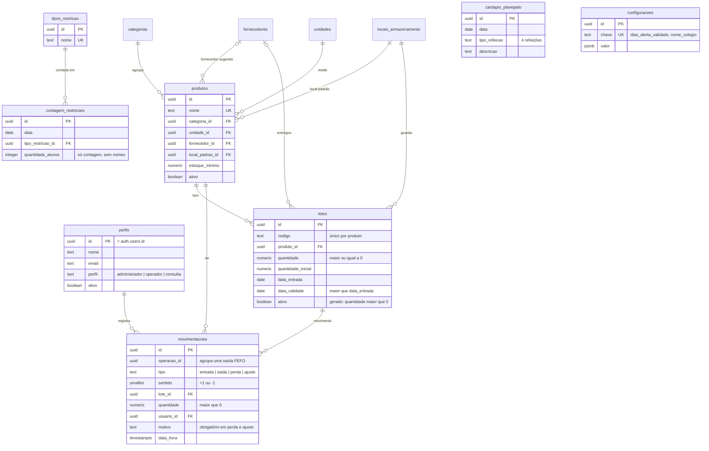
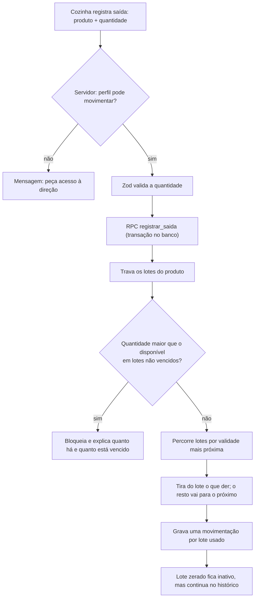
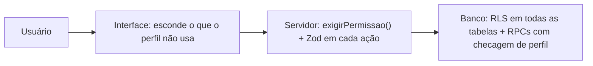
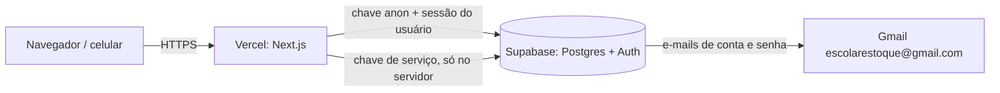

# Diagramas

Os diagramas estão em [Mermaid](https://mermaid.js.org/) e aparecem desenhados no GitHub e no VS Code.

## Modelo de dados

Também existem `categorias`, `unidades`, `fornecedores` e `locais_armazenamento` (nome e dados de contato/descrição).

## Saída FEFO

## Permissões em três camadas

## Publicação

